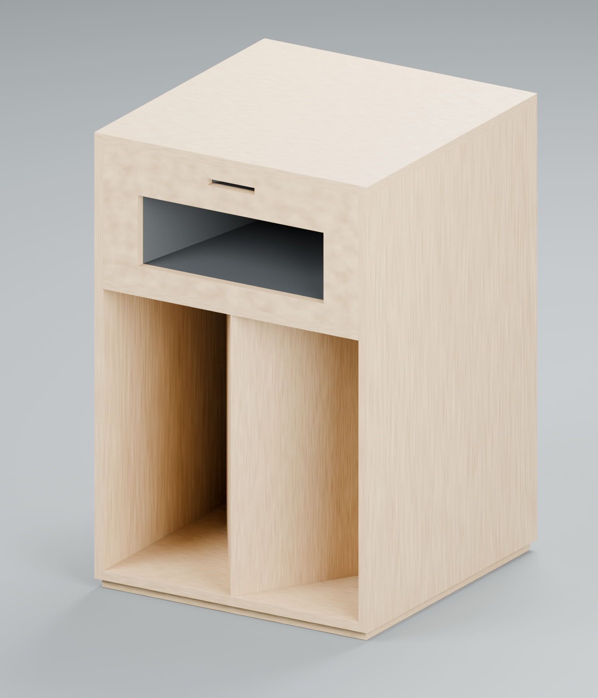

# La Scala OG (1977) — Development

A from-scratch CAD reconstruction of the 1977 factory Klipsch La Scala. Part of [BRPL](https://github.com/brplspkr) speaker work.

**Start with [`START_HERE.txt`](START_HERE.txt).** (It also describes an SS-18 stack variant that isn't published here.)

## What's here

| Version | What it is | Main files |
|---|---|---|
| **LF Only R3** | Bass bin only, for freestanding upper horns. 603.25 × 622.3 × 622.3 mm | `LaScala_OG_LF_Only_R3_*` |
| **R2** | Complete 3-way cabinet with reference driver/horn placeholders | `LaScala_OG_1977_R2_*` |
| R1 | Initial reference model, kept for history | `R1 Reference Model/` |

Each version ships a native FreeCAD model (`.FCStd`), STEP exports, renders, notes, and a `* Build Files/` folder with the scripts that regenerate it plus validation JSON.

## Status / known uncertainties

- Dimensions come from the 1977 factory dimension sheets and cut list. See the notes files for the open items (wing angle 31.2° in the model vs. 30° on the drawing, mid cutout width, bottom-panel/overall-height conflict).
- Driver and horn models are **placeholders** for clearance and path-length estimates only. The MF horn is not a K-400 profile.
- Rough 1D models put the LF bin's group delay at about 3 ms around 80 Hz, so a front-loaded sealed or ported sub stacked underneath lines up within ~1–2 ms on an 80 Hz LR24 analog crossover — confirm with a measurement.

## Not included

Third-party reference material (the Klipsch brochure, factory dimension drawings, photos) isn't redistributed here. The factory drawings circulate on the [Klipsch Audio Community](https://community.klipsch.com/topic/179112-la-scala-lf-build/).

Klipsch and La Scala are trademarks of Klipsch Group, Inc. This is an independent hobby reconstruction, not affiliated with or endorsed by Klipsch.
